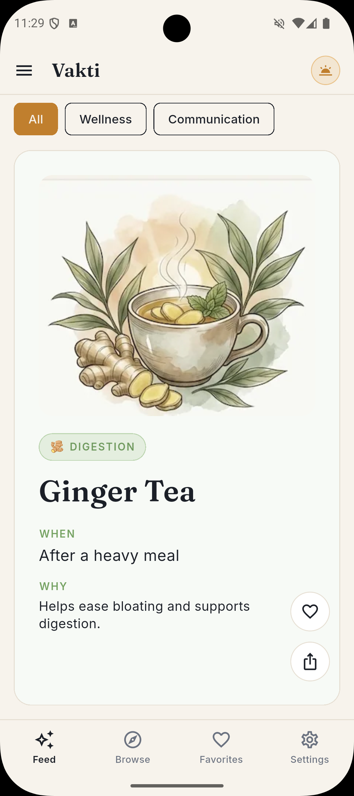
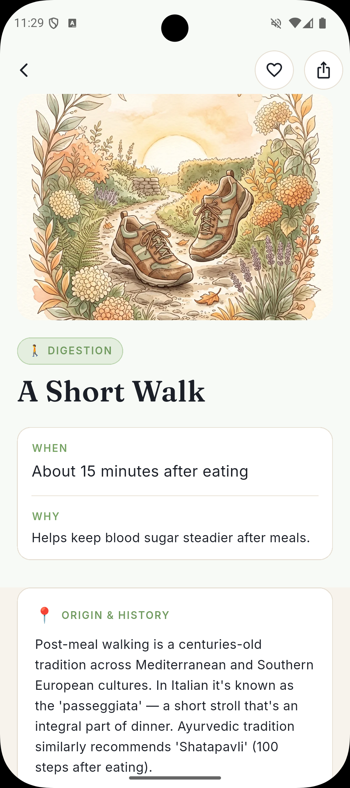
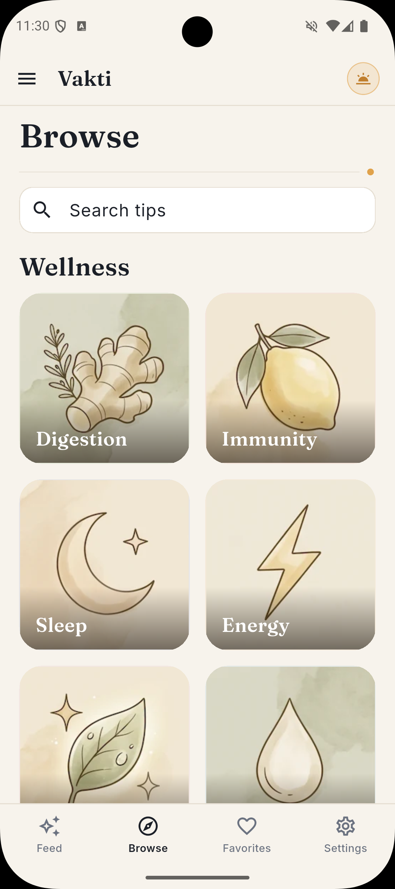
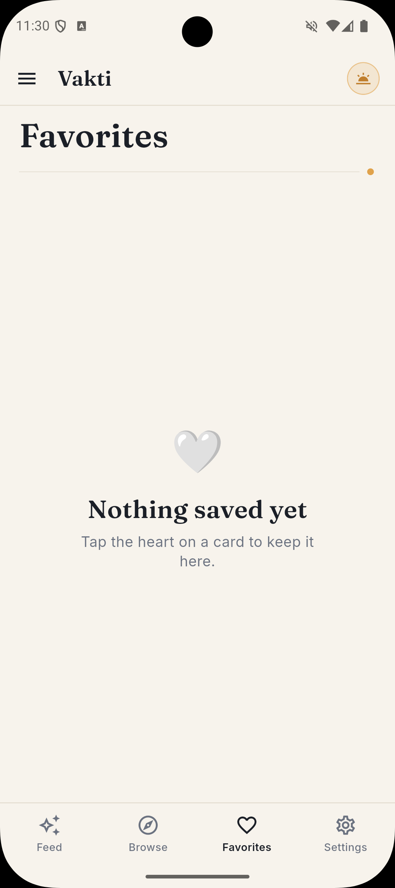
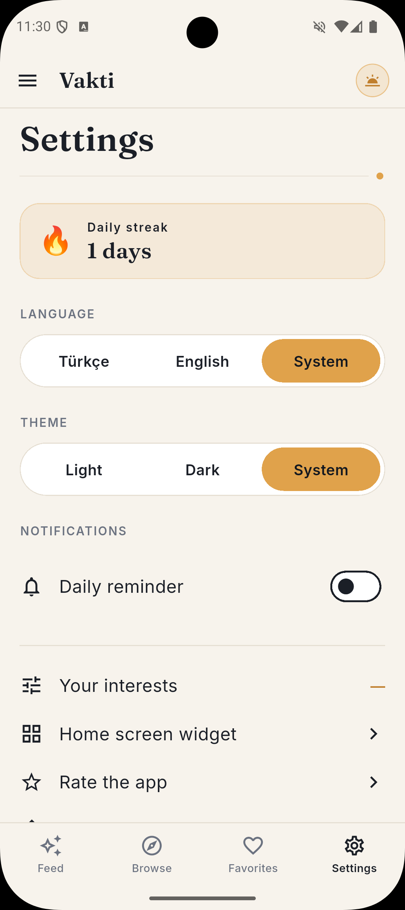

  
  
  
  

<em>One calm tip card a day that tells you what to do, when and why. 
This repository is the public showcase; the source code is kept private.</em>

<table>
  <tr>
    <td width="20%"></td>
    <td width="20%"></td>
    <td width="20%"></td>
    <td width="20%"></td>
    <td width="20%"></td>
  </tr>
</table>

## What it is

Vakti turns small, well-timed advice into a daily ritual. There is no feed, no account and no ads, and all content ships inside the app, so it works fully offline.

| Pillar | Topics |
|---|---|
| **Wellness** | Digestion, immunity, sleep, energy, skin, hydration |
| **Communication** | Boundaries, emotions, cooperation, confidence, early years |

## Highlights

| | |
|---|---|
| **Tip cards** | Each card explains the when and the why, with origin, how-to-use and a "did you know". |
| **Home widget** | A golden-hour widget with the time-arc motif and your streak. |
| **Daily streak** | Build a gentle habit, one day at a time. |
| **Search and favourites** | Find any tip in either language and keep the ones you love. |
| **Share cards** | Send any tip as a ready-made image. |
| **Privacy** | No analytics, no tracking, no data collected. |

## The catalogue

96 cards in 12 categories, eight cards each, all bundled with the app on Google Play:

| Pillar | Categories |
|---|---|
| **Wellness** | Digestion · Immunity · Sleep · Energy · Skin · Hydration |
| **Communication** | Boundaries · Emotions · Cooperation · Confidence · Early years · Relationships |

Every card carries a title, a primary and a secondary line with their labels (the *when* and the *why*), and a longer detail with origin, how to use it and a "did you know".

## Türkçe özet

**Vakti**, doğru bilgiyi doğru vakitte sunan ücretsiz, reklamsız ve tamamen çevrimdışı bir ipucu uygulaması. Her gün tek bir kart, ne yapacağını, ne zaman ve neden yapacağını anlatıyor. Sağlık ve iletişim olmak üzere iki ana başlık, ana ekran widget'ı ve günlük seri takibi var. Bu depo uygulamanın vitrinidir; uygulama Google Play'de, kaynak kod gizli.

 

Doğru bilgi, doğru vakitte · built with Flutter by Studio Rosemary · the card in the banner is illustrative.

